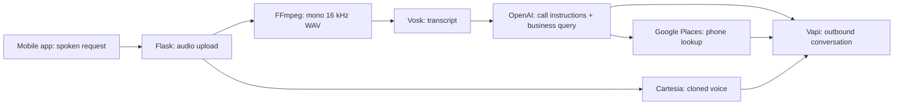

# Agent BOB
### Let your voice do the calling.

Agent BOB is a JAMHacks team prototype for delegating routine phone tasks to a personalized voice agent. Record a request in the app; the backend turns it into instructions for an outbound call delivered using a cloned voice.

The interesting challenge was negotiation: a convincing voice is only useful if the agent stays grounded in what the user actually asked for.

## What we built

- A React Native / Expo app for recording audio and registering a voice profile.
- A Flask backend for account handling, audio uploads and orchestration.
- Audio conversion with FFmpeg and local speech recognition with Vosk.
- Cartesia voice cloning and Vapi outbound calling, with OpenAI-generated call instructions.
- An experimental transcript-ingestion script using sentence-transformer embeddings and MongoDB.

This repository preserves a hackathon implementation. It needs configuration and cleanup before reproducing a live demo; it is not a production service.

## Follow the request



The diagram shows the intended request flow in the code. The checked-in call route overrides the looked-up destination with a fixed demo number, so that override must be removed or deliberately replaced before any call is attempted.

## My contribution

I'm Hamzah Ali. I contributed to the frontend, backend, pipeline integration and prompting. My work included using past-call transcripts as conversational context and working on the hardest behavior problem: getting the agent to negotiate usefully without inventing details.

The team's transcript-context experiments and the committed implementation are not identical: `ingest.py` contains embedding/storage work, but the committed `app.py` does not connect a retrieval query to the live call prompt. This repository does not demonstrate model fine-tuning.

## Engineering lesson: fluent does not mean reliable

A negotiation agent needs a clear objective, trustworthy context and limits on what it can agree to. The current prompt asks the model to infer missing details, which creates a concrete grounding problem.

The next iteration should ask for missing information, make user constraints explicit and test cases where the agent must decline or defer. Useful measurements would include unsupported claims, constraint violations, task completion and response latency. These are proposed evaluations; no benchmark results are claimed here.

## Code map

| File | Responsibility |
| --- | --- |
| [app.py](jamhacks_project/app.py) | Flask routes, accounts, audio conversion, transcription, voice cloning and call orchestration |
| [voicerecord.tsx](jamhacks_project/auto_caller/app/voicerecord.tsx) | Voice recording and registration UI |
| [_layout.tsx](jamhacks_project/auto_caller/app/_layout.tsx) | App layout and interaction flow |
| [ingest.py](jamhacks_project/ingest.py) | Experimental transcript embedding and MongoDB ingestion |
| [requirements.txt](jamhacks_project/requirements.txt) | Backend dependency pins |
| [package.json](jamhacks_project/auto_caller/package.json) | Mobile dependencies and scripts |

## Reproducing the prototype

Start by reading the code map above. Live calls have **not** been retested as part of this documentation update.

The backend needs Python, FFmpeg, a Vosk model in `jamhacks_project/model/`, and these environment variables:

```dotenv
OPENAI_API_KEY=
VAPI_API_KEY=
VAPI_ASSISTANT_ID=
VAPI_PHONE_NUMBER_ID=
CARTESIA_API_KEY=
GCP_API_KEY=
```

The app uses Expo, React Native and TypeScript. Its package scripts include `npm start`, `npm run android`, `npm run ios` and `npm run web`.

Before launching:
- Use a fresh local database. The current backend startup deletes existing account rows.
- Replace hard-coded mobile backend URLs with your development endpoint.
- Review the fixed call destination and use only an explicitly authorized test recipient.
- Check provider SDK compatibility against the pinned packages.
- Repair the transcript loader before using it: its path loop is unfinished, the MongoDB connection needs configuration, and its dependencies are not included in the backend requirements file.

Use your own voice or a voice you have permission to use, and synthetic or consented transcripts. The prototype has no completed production authentication/session layer or published security guarantees.

## What comes next

1. Connect transcript retrieval to the call-time context and measure whether it improves grounding.
2. Replace inferred personal details with explicit user confirmation.
3. Add reproducible tests for negotiation constraints and failure recovery.
4. Separate configuration, remove generated environments/demo data from version control, and record a clean demo.
