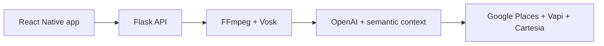

# Agent BOB

**A personalized voice agent that handles routine phone calls in the user's voice and communication style.**

Agent BOB is an end-to-end JAMHacks prototype for delegating phone tasks such as booking appointments, placing orders, and contacting local businesses. A user speaks a request into the mobile app; the system transcribes it, builds call instructions, finds the business, and launches an outbound AI conversation using the user's cloned voice.

Beyond sounding like the user, Agent BOB uses semantically indexed recordings and transcripts as context for how the user phrases requests and responds in conversations.

## How it works

1. **Create a voice profile** - The user records a voice sample in the React Native app.
2. **Capture a task** - The user records a request such as "Book a haircut for Friday afternoon."
3. **Process the audio** - FFmpeg normalizes the recording and Vosk transcribes it locally.
4. **Plan the call** - OpenAI converts the request into task-specific instructions and extracts the intended business.
5. **Find the recipient** - Google Places resolves the business and phone number.
6. **Place the call** - Vapi runs the conversation using a Cartesia-cloned voice.
7. **Personalize responses** - Recordings and past-call transcripts are semantically indexed so relevant examples of the user's communication style can be supplied as conversational context.



## Core capabilities

- Cross-platform mobile interface built with React Native, Expo, and TypeScript
- Flask API for accounts, audio uploads, transcription, and call orchestration
- Audio conversion and normalization with FFmpeg
- Local speech recognition with Vosk
- Voice cloning through Cartesia
- Outbound conversational calls through Vapi
- LLM-generated, task-specific call instructions
- Business discovery and phone lookup through Google Places
- Semantic indexing of user recordings and transcripts with sentence-transformer embeddings and MongoDB

## Technology

| Layer | Technologies |
| --- | --- |
| Mobile | React Native, Expo, TypeScript |
| Backend | Python, Flask, SQLAlchemy, SQLite |
| Audio | FFmpeg, Vosk |
| AI | OpenAI, sentence-transformer embeddings |
| Voice and calls | Cartesia, Vapi |
| Data and retrieval | MongoDB, semantic search |
| External services | Google Places API |

## My contribution

I contributed across the mobile interface, Flask backend, audio pipeline, API integrations, and agent prompting. My work focused on connecting the end-to-end call flow and improving personalization: using recordings and past conversations as semantic context so the agent could better reflect how the user communicates while staying focused on the requested task.

## Repository map

| Path | Responsibility |
| --- | --- |
| [`jamhacks_project/app.py`](jamhacks_project/app.py) | Flask routes, accounts, audio processing, transcription, voice cloning, business lookup, and call orchestration |
| [`voicerecord.tsx`](jamhacks_project/auto_caller/app/voicerecord.tsx) | Voice recording, registration, upload, and mobile feedback |
| [`ingest.py`](jamhacks_project/ingest.py) | Transcript embeddings and MongoDB ingestion for semantic personality context |
| [`requirements.txt`](jamhacks_project/requirements.txt) | Python dependencies |
| [`package.json`](jamhacks_project/auto_caller/package.json) | Expo and React Native dependencies |

## Run locally

### Prerequisites

- Python 3
- Node.js
- FFmpeg
- A Vosk English model
- API credentials for OpenAI, Vapi, Cartesia, and Google Places

### Environment variables

```dotenv
OPENAI_API_KEY=
VAPI_API_KEY=
VAPI_ASSISTANT_ID=
VAPI_PHONE_NUMBER_ID=
CARTESIA_API_KEY=
GCP_API_KEY=
```

### Backend

```bash
cd jamhacks_project
pip install -r requirements.txt
python app.py
```

### Mobile app

```bash
cd jamhacks_project/auto_caller
npm install
npm start
```

Before running the mobile app, replace the development backend URL with the address of your Flask server.

## Prototype status

Agent BOB is complete as a hackathon proof of concept, not a production calling service. The checked-in call route uses a fixed authorized demo number, the local account database resets when the backend starts, and production authentication, automated tests, monitoring, and failure recovery remain future work.

The semantic personalization approach uses recordings and transcripts as retrievable context. It should not be described as model-weight fine-tuning unless a separately trained model is added.

Only use voices, recordings, transcripts, and phone recipients for which you have permission.
